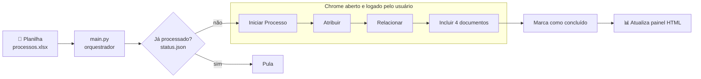

<div align="center">

# 🤖 Automação SEI

**Automação de ponta a ponta para criação de processos e inclusão de documentos no SEI (Sistema Eletrônico de Informações), a partir de uma planilha.**

[](https://www.python.org/)
[](https://playwright.dev/python/)
[](https://pandas.pydata.org/)


**Série:** **Parte 1: Criação de processos** •
[Parte 2: Documentos pessoais](https://github.com/ThiagoDionisio05/sei-automacao-pt2) •
[Parte 3: Documentos nativos personalizados](https://github.com/ThiagoDionisio05/sei-automacao-pt3)

[Visão geral](#-visão-geral) •
[Como funciona](#-como-funciona) •
[Decisões técnicas](#-decisões-técnicas) •
[Como rodar](#-como-rodar) •
[Estrutura](#-estrutura-do-projeto) •
[Aprendizados](#-o-que-aprendi)

</div>

---

## 📌 Visão geral

No SEI, criar um processo e anexar seus documentos padrão é um trabalho
manual e repetitivo: são dezenas de cliques, formulários dentro de iframes e
campos que carregam via AJAX — **para cada processo**. Quando há dezenas ou
centenas de processos para abrir, isso consome horas e aumenta o risco de erro
humano.

Este projeto automatiza o fluxo completo, lendo os dados de uma planilha Excel:

1. **Inicia o processo** (tipo, especificação, nível de acesso, hipótese legal)
2. **Atribui** o processo a um usuário
3. **Relaciona** o processo a um processo de referência
4. **Inclui os documentos externos** (4 PDFs padrão), conferindo cada anexo
5. **Registra o progresso** e atualiza um painel HTML de acompanhamento

<!-- 💡 Dica: adicione aqui um número real de impacto, ex.:
"Reduziu de ~X min para ~Y min o tempo por processo, em N processos criados." -->

### Destaques

| | |
|---|---|
| 🔐 **Seguro por design** | Login sempre manual, a automação **nunca assina** documentos, e nenhuma credencial fica no código |
| 🧪 **Dry-run por padrão** | Preenche os formulários mas não salva nada até você passar `--run` |
| ♻️ **Idempotente** | Se cair no meio do lote, rodar de novo retoma de onde parou, sem duplicar processos |
| ✅ **Verificação ativa** | Depois de cada ação, confere se ela aconteceu de fato (o processo foi criado? o documento apareceu na árvore?) |
| 📸 **Rastreável** | Screenshot de cada etapa para auditoria e depuração |
| 📊 **Painel de acompanhamento** | Página HTML com os processos criados, edição local e exportação para CSV |

---

## ⚙️ Como funciona



A automação **não abre o próprio navegador**. Ela se conecta via
**CDP (Chrome DevTools Protocol)** a uma janela do Chrome que o usuário abriu
e na qual fez login manualmente. Isso evita guardar credenciais e respeita
autenticações com captcha ou 2FA.

---

## 🧠 Decisões técnicas

Esta seção explica o *porquê* de cada escolha. É a parte mais útil para quem
quer estudar automação web em sistemas legados.

<details>
<summary><b>1. Conectar num navegador existente (CDP) em vez de lançar um novo</b></summary>

<br>

```python
browser = playwright.chromium.connect_over_cdp("http://localhost:9222")
```

- O usuário faz o login, então **nenhuma senha passa pelo código**.
- A automação nunca fecha o navegador, que continua sob controle do usuário.
- A porta de depuração fica presa ao `127.0.0.1`, então só aceita conexões da
  própria máquina (veja [`src/browser.py`](src/browser.py)).

</details>

<details>
<summary><b>2. Lidar com iframes e carregamentos assíncronos</b></summary>

<br>

O SEI renderiza menu, árvore e formulários em **frames separados**, e vários
`<select>` recebem suas opções via AJAX depois que a página carrega. Por isso:

- [`frame_conteudo()`](src/sei_page.py) localiza o iframe certo antes de cada interação;
- [`selecionar_select_por_rotulo()`](src/sei_page.py) faz *polling* até a opção aparecer;
- [`esperar_carregar()`](src/sei_page.py) usa `networkidle` **com timeout curto**, porque o
  SEI mantém requisições de fundo (heartbeat) que nunca deixam a rede "ociosa".

</details>

<details>
<summary><b>3. Localizar elementos por rótulo visível, com fallback</b></summary>

<br>

Seletores CSS/ID mudam entre instâncias do SEI. A estratégia principal é
localizar pelo que o usuário enxerga (rótulo, texto, `title` do ícone), com o
seletor configurado como plano B:

```python
def clicar_por_texto_ou_icone(page, texto):
    # 1º tenta pelo texto visível → 2º pelo ícone (img/title/aria-label)
    ...
```

O resultado é uma automação mais resistente a mudanças de layout.

</details>

<details>
<summary><b>4. Nunca confiar que uma ação deu certo — verificar</b></summary>

<br>

Clicar em "Salvar" não garante que o registro foi salvo. Depois de cada ação
crítica, o código confere o resultado:

- **Processo**: se ainda está no formulário, se caiu numa página de erro ou se
  voltou para "Controle de Processos" sem número, levanta um erro claro.
- **Número do processo**: três estratégias em cascata (texto da tela, botão
  nativo "Copiar Número" via clipboard, seletor configurado).
- **Documento**: recarrega a página e confirma que o documento **aparece na
  árvore** do processo.
- **Anexo**: confere o contador "Lista de Anexos (N registros)", com até 3 tentativas.

</details>

<details>
<summary><b>5. Idempotência e recuperação de falhas</b></summary>

<br>

O progresso fica em `status/processados.json`, gravado **logo após** a criação
do processo (antes dos documentos). Assim:

- Se o lote cair, rodar de novo **não duplica** processos já criados;
- Processos criados pela metade são listados no final, com o comando exato
  para completá-los (`testar_documento.py`);
- Uma falha numa linha não interrompe o lote: ela é registrada, e o processamento segue.

</details>

<details>
<summary><b>6. Configuração separada do código</b></summary>

<br>

Seletores, tipos de processo e nomes de documentos ficam centralizados em
[`src/config.py`](src/config.py). Dados reais (usuário, números de processo,
PDFs) ficam em `src/config_local.py`, que **não é versionado** e sobrescreve os
valores de exemplo.

</details>

---

## 🚀 Como rodar

### Pré-requisitos

- Python 3.10+
- Google Chrome
- Acesso a uma instância do SEI

### 1. Instalação

```powershell
git clone https://github.com/ThiagoDionisio05/sei-automacao.git
cd sei-automacao
python -m venv .venv
.venv\Scripts\activate
pip install -r requirements.txt
playwright install chromium
```

### 2. Configuração

```powershell
copy src\config_local.example.py src\config_local.py   # preencha com seus dados
python -m src.criar_planilha_exemplo                    # gera data/processos.xlsx
```

Coloque os PDFs que serão anexados em `src/PDFs/` e ajuste os caminhos em
`config_local.py`. Se a sua instância do SEI tiver seletores diferentes, use o
gravador do Playwright para capturá-los:

```powershell
playwright codegen https://sua-instancia-do-sei
```

### 3. Abrir o Chrome com depuração remota

```powershell
& "C:\Program Files\Google\Chrome\Application\chrome.exe" `
  --remote-debugging-port=9222 `
  --remote-debugging-address=127.0.0.1 `
  --user-data-dir="C:\ChromeSEIAutomacao"
```

Faça login no SEI nessa janela. Ela usa um perfil separado do seu Chrome do
dia a dia.

> [!WARNING]
> A porta 9222 não tem autenticação: qualquer processo local pode controlar
> essa janela. Abra-a **só quando for rodar a automação** e feche-a ao terminar.

### 4. Executar

| Comando | O que faz |
|---|---|
| `python main.py` | **Dry-run**: preenche 1 processo, não salva nada |
| `python main.py --run --linha 0` | Executa de verdade apenas a linha 0 |
| `python main.py --run` | Cria os processos de todas as linhas pendentes |
| `python main.py --run --com-documentos` | Fluxo completo, incluindo os 4 documentos |
| `python testar_documento.py <nº> [nota\|despacho\|...]` | Completa os documentos de um processo já aberto |

> [!NOTE]
> A automação **nunca assina documentos**. A assinatura é sempre manual, no SEI.

---

## 📁 Estrutura do projeto

```
sei-automacao/
├── main.py                    # Orquestrador (CLI): lê a planilha e executa o fluxo
├── testar_documento.py        # Inclui documentos num processo já aberto
├── painel_processos.html      # Painel de acompanhamento (localStorage + CSV)
├── requirements.txt
└── src/
    ├── config.py              # Seletores, caminhos e valores padrão
    ├── config_local.example.py# Modelo para os dados reais (não versionados)
    ├── browser.py             # Conexão com o Chrome via CDP
    ├── sei_page.py            # Helpers: frames, cliques, selects, anexos, verificações
    ├── processo.py            # Iniciar, atribuir, relacionar e sair do processo
    ├── documento.py           # Inclusão e verificação de documentos externos
    ├── planilha.py            # Leitura do Excel + controle de status (idempotência)
    ├── painel.py              # Gera os dados do painel HTML
    └── criar_planilha_exemplo.py
```

Arquivos gerados em tempo de execução (`screenshots/`, `status/`, `data/`,
`dados_processos.js`) e o perfil do navegador ficam fora do repositório via
`.gitignore`.

---

## 📚 O que aprendi

- **Automação de sistemas legados**: iframes aninhados, campos com máscara JS
  (que exigem digitar tecla por tecla em vez de `fill()`) e radios que só
  aceitam `check(force=True)`.
- **Esperas inteligentes**: por que `networkidle` sozinho trava em sistemas
  com heartbeat, e como combinar timeout curto com *polling* do estado esperado.
- **Confiabilidade**: verificar o efeito de cada ação em vez de assumir que
  ela deu certo, e projetar o fluxo para ser retomável (idempotência).
- **Segurança operacional**: manter credenciais fora do código, separar
  configuração de dados sensíveis e entender os riscos de expor uma porta CDP.

## 🗺️ Próximos passos

- [ ] Testes automatizados para os helpers de `sei_page.py`
- [ ] Logging estruturado no lugar de `print`
- [ ] Configuração via `.env` / YAML
- [ ] Paralelizar em múltiplas abas

---

## ⚠️ Aviso

Projeto independente, criado para uso pessoal e fins de estudo. **Não é
afiliado nem endossado** por nenhum órgão público ou pelos mantenedores do SEI.
Use apenas em sistemas aos quais você tem acesso autorizado e de acordo com as
políticas da sua instituição.

Código disponibilizado apenas para consulta, como portfólio. Nenhuma licença de uso é concedida.

<div align="center">

Feito por **Thiago Dionisio** · [GitHub](https://github.com/ThiagoDionisio05)

</div>
